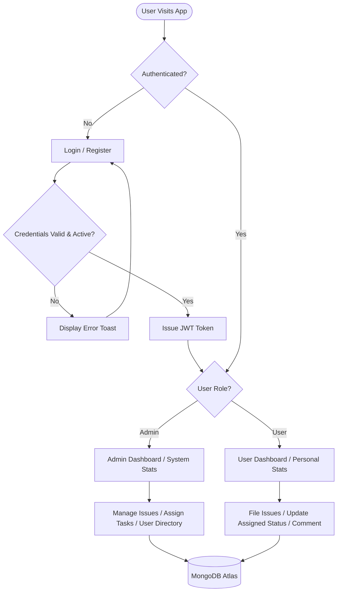
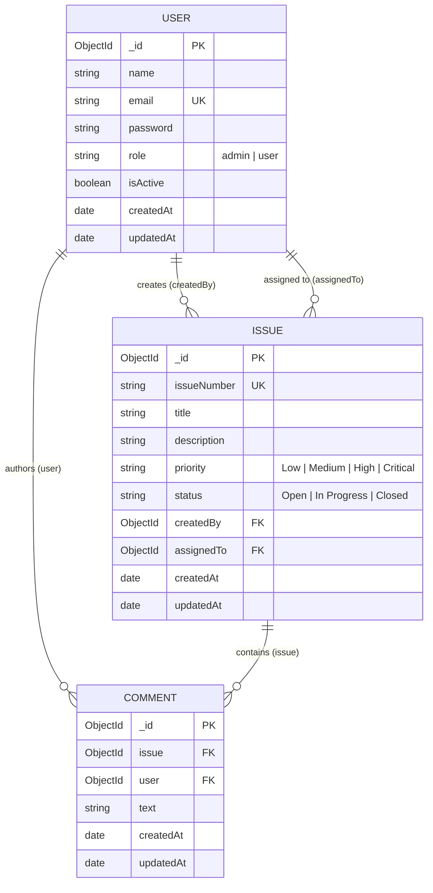

# Business Requirements Document (BRD)
## Enterprise Issue Tracker System — Exelon Circuits

**Document Version:** 1.0.0  
**Target Organization:** Exelon Circuits  
**Prepared By:** Senior Full-Stack Software Engineering Team (Candidate: Aneesh2078)  
**Date:** November 2026  
**Status:** Approved for Implementation  

---

## 1. Introduction

This Business Requirements Document (BRD) defines the comprehensive functional specifications, operational objectives, non-functional criteria, database structures, and cloud deployment procedures for the **Exelon Circuits Issue Tracker System**. The document establishes a definitive standard for software quality, security, and architectural integrity for evaluation under the Exelon Circuits full-stack technical assessment.

---

## 2. Project Overview

Exelon Circuits designs and manufactures mission-critical printed circuit board assemblies (PCBAs) and embedded electronics. Quality control and fast incident resolution are essential to manufacturing operations. The Issue Tracker System is an internal company web application engineered to track hardware bugs, assembly anomalies, software defects, and maintenance tasks across departments with strict role-based authorization, automated issue indexing, and live analytical tracking.

---

## 3. Problem Statement

Historically, engineering issues were reported via fragmented channels (email, instant messages, ad-hoc spreadsheets), leading to:
1. **Lack of Central Accountability:** Issues were lost in chat threads with no definitive assignee.
2. **Ambiguous Prioritization:** Critical PCB defects were not distinguishable from routine component suggestions.
3. **Audit & Compliance Gaps:** No permanent chronological log existed for troubleshooting discussions or status transitions.
4. **Administrative Blindspots:** Management lacked live metrics on issue resolution velocity, workload distribution, and recurring defect categories.

---

## 4. Project Objectives

- **Centralize Defect Management:** Provide a unified repository for all issues identified across design, fabrication, and testing.
- **Implement Strict Role-Based Access Control (RBAC):** Restrict system governance, user account deactivation, and ticket deletion to administrators, while giving standard engineers personal task visibility.
- **Enforce Consistent Workflow:** Provide a structured lifecycle (`Open` -> `In Progress` -> `Closed`) with clear ownership rules.
- **Deliver Real-Time Metrics:** Compute dynamic metrics from MongoDB records without hardcoded values.
- **Provide Utilitarian UI/UX:** Offer a clean, distraction-free corporate interface inspired by modern enterprise Jira instances.

---

## 5. Project Scope

### In-Scope
- User self-registration (guaranteed `user` role) and secure login with bcrypt password hashing and JWT issuance.
- Automated sequential issue number generation (e.g., `EX-1001`, `EX-1002`).
- CRUD operations for issues, filtered by role and assignment.
- Administrative task delegation (assigning issues to active users).
- Threaded chronological discussion comments for collaborative troubleshooting.
- Administrative user directory with active/inactive account toggling and assigned ticket metrics.
- Metric cards and status distribution charts (Recharts) populated dynamically.
- Production deployment across GitHub, Vercel, Railway, and MongoDB Atlas.

### Out-of-Scope (Future Enhancements)
- Automated email/SMS notification webhooks.
- Multi-tenancy across separate corporate subsidiaries.
- Drag-and-drop Kanban board layout (reserved for v2.0).

---

## 6. Stakeholders

- **Engineering Managers / QA Leads:** Act as **Administrators**, monitoring overall throughput, delegating tasks, managing accounts, and deleting obsolete tickets.
- **Hardware & Software Engineers:** Act as **Normal Users**, filing issues, progressing assigned tickets from `Open` to `Closed`, and collaborating via comments.
- **Exelon Circuits Technical Assessment Panel:** Evaluating technical completeness, architecture, code cleanliness, and security.

---

## 7. User Roles & Access Rights Matrix

| Permission / Function | Administrator (`admin`) | Standard Engineer (`user`) |
| :--- | :---: | :---: |
| Self-Registration | Auto-assigned `user` | Auto-assigned `user` |
| View System Overview Dashboard | Full System Data | Personal / Assigned Data |
| View All Issues | All Issues in DB | Created by / Assigned to Self |
| Create Issue | Allowed (Can assign) | Allowed (Cannot assign) |
| Edit Issue | All Issues & Fields | Own Created (Restricted Fields) |
| Reassign Issue | Allowed | Denied (403 Forbidden) |
| Update Status (`Open`, `In Progress`, `Closed`) | Allowed on Any | Allowed on Assigned Only |
| Delete Issue | Allowed | Denied (403 Forbidden) |
| Post Comments | Allowed on Any | Allowed on Permitted Issues |
| Delete Comments | Any Comment | Own Comments Only |
| User Directory View | Full Directory | Denied (403 Forbidden) |
| Activate / Deactivate Accounts | Allowed | Denied (403 Forbidden) |

---

## 8. Functional Requirements

### FR-01: Authentication & Authorization
- **FR-01.1:** System shall validate email format and enforce minimum 6-character passwords.
- **FR-01.2:** System shall prevent duplicate registrations under identical email addresses.
- **FR-01.3:** Public registration must never allow selection or assignment of the `admin` role.
- **FR-01.4:** Initial administrator account must be established via backend seed script using environment variables.
- **FR-01.5:** Authenticated sessions must be maintained using JWT tokens sent via the HTTP `Authorization: Bearer <token>` header.
- **FR-01.6:** Deactivated accounts must be immediately blocked from logging in or making authorized requests.

### FR-02: Issue Management & Lifecycle
- **FR-02.1:** Each issue must receive an automatically generated, sequential identifier formatted as `EX-XXXX`.
- **FR-02.2:** Issues must require a Title (max 200 chars), Description, and Priority (`Low`, `Medium`, `High`, `Critical`).
- **FR-02.3:** Status must transition strictly between `Open`, `In Progress`, and `Closed`.
- **FR-02.4:** Admins can assign any active user to an issue during creation or via assignment modal.
- **FR-02.5:** Normal users can only edit issues they created and cannot alter assignment or restricted properties.
- **FR-02.6:** Normal users can update the status of issues explicitly assigned to them.
- **FR-02.7:** Issue deletion is strictly restricted to Administrators and cascades to delete related comments.

### FR-03: Threaded Discussions & Comments
- **FR-03.1:** Users can append comments up to 2,000 characters to issues they are authorized to view.
- **FR-03.2:** Comments must display commenter name, role badge, timestamp, and text in chronological order.
- **FR-03.3:** Comment deletion is restricted to the original author or any Administrator.

### FR-04: Analytical Dashboards
- **FR-04.1:** Dashboards must render 4 core KPI cards: Total Issues, Open Issues, In Progress, Closed.
- **FR-04.2:** Admin dashboard computes metrics across all database records; User dashboard scopes metrics to tickets created by or assigned to the logged-in user.
- **FR-04.3:** Dashboards must display a recent issues table and visual status breakdown chart using Recharts.
- **FR-04.4:** All metrics must be computed dynamically by MongoDB queries (no static or hardcoded metrics).

### FR-05: User Directory Management (Admin Portal)
- **FR-05.1:** Admins can view all registered users with their name, email, role, registration date, and assigned ticket count.
- **FR-05.2:** Admins can toggle account active status. Self-deactivation by the active admin is disallowed.

---

## 9. Non-Functional Requirements

- **Performance:** API response times must average under 150ms for indexed MongoDB queries.
- **Reliability:** The Express backend must gracefully handle database disconnections without unhandled process termination.
- **Security:** Passwords must be hashed using bcrypt (10 rounds). Password hashes must never be serialized in JSON responses.
- **Responsiveness:** Layout must function seamlessly across desktop (1920x1080), tablet (768px), and mobile (375px) viewports.
- **Accessibility & Contrast:** Palette conforms to WCAG AA contrast standards (#2563EB against white, #1E293B on #F8FAFC).

---

## 10. System Architecture & Component Interaction

```
+-----------------------------------------------------------------------+
|                            CLIENT TIER                                |
|  React 18 SPA (Vite) | Tailwind CSS | React Router v6 | Recharts     |
|  - AuthContext (Session & Role Management)                            |
|  - ToastContext (Real-time notifications)                             |
|  - Axios API Client (Bearer Token Interceptors)                       |
+-----------------------------------+-----------------------------------+
                                    |
                            HTTP/REST API Calls
                                    |
+-----------------------------------v-----------------------------------+
|                           API GATEWAY TIER                            |
|  Node.js & Express.js Application Server                              |
|  - CORS Whitelisting Middleware                                       |
|  - express-validator Middleware                                       |
|  - JWT Authentication Middleware (`protect`)                          |
|  - Role-Based Access Control Middleware (`adminOnly`)                 |
|  - Global Centralized Error Handling                                  |
+-----------------------------------+-----------------------------------+
                                    |
                             Mongoose ODM v8
                                    |
+-----------------------------------v-----------------------------------+
|                            DATA TIER                                  |
|  MongoDB Atlas Cluster / Local MongoDB                                |
|  - Users Collection (Indexed email, role, isActive)                   |
|  - Issues Collection (Indexed issueNumber, status, priority, refs)    |
|  - Comments Collection (Compound indexed issue + createdAt)           |
+-----------------------------------------------------------------------+
```

---

## 11. Use Case Descriptions

### UC-01: Incident Reporting by Engineer
1. Engineer logs into the portal.
2. Selects **Create Issue** from the sidebar or dashboard.
3. Fills in Title ("Short circuit on PCB rev B power rail"), Description, and selects `Critical` priority.
4. Clicks **Submit Issue**.
5. System auto-generates identifier `EX-1001`, persists record, and redirects engineer to the issue details view.

### UC-02: Issue Delegation & Status Lifecycle
1. Admin logs into the portal, opens **All Issues**, and views `EX-1001`.
2. Clicks **Assign**, selects "Jane Doe (Hardware Engineer)" from the active user dropdown, and saves.
3. Jane Doe logs in, sees `EX-1001` in her **Assigned to Me** queue.
4. Jane opens the ticket, changes status from `Open` to `In Progress`, and posts a comment: "Commencing voltage drop diagnostics on bench 4."
5. Upon repairing the trace, Jane updates status to `Closed` and notes the resolution in comments.

---

## 12. Application Workflow



---

## 13. Database Design



---

## 14. Technology Stack Justification

| Technology | Selected | Justification |
| :--- | :--- | :--- |
| **Frontend** | React 18 + Vite | Lightning-fast development builds, component-driven modularity, and optimized production chunking. |
| **Styling** | Tailwind CSS | Utility-first CSS ensuring strict adherence to the minimal Jira-style palette without bloated stylesheets. |
| **Icons** | Lucide React | Clean, modern, lightweight SVG icons that convey clear intent without visual clutter. |
| **Charts** | Recharts | Declarative SVG charting with native React integration and responsive sizing. |
| **Backend** | Express.js | Industry standard for RESTful architectures with rich middleware ecosystem for JWT and validation. |
| **Database** | MongoDB Atlas + Mongoose | Schema validation with the flexibility of document storage; ideal for hierarchical comment threads and agile issue records. |

---

## 15. Security Requirements & Standards

1. **Password Protection:** Plaintext passwords are encrypted using `bcryptjs` with salt round cost factor 10 prior to document persistence.
2. **Zero Plaintext Password Exposure:** The `User` Mongoose schema overrides `.toJSON()` and applies `.select('-password')` across controllers to ensure credentials never leave the database layer.
3. **Role Spoofing Prevention:** Public registration routes forcefully set `role: 'user'`, ignoring any client-injected role payload.
4. **Backend-Enforced Authorization:** Every endpoint verifies the bearer JWT and evaluates resource ownership on the server side; frontend UI guards serve as UX helpers only.
5. **CORS Policy:** Restricts access to authorized client origins (`CLIENT_URL`, localhost development ports, and Vercel domains).

---

## 16. Assumptions and Constraints

- **Single Organization:** System operates as a unified tenant for Exelon Circuits.
- **Node.js Environment:** Requires Node.js v18 or newer.
- **Modern Browsers:** Target browsers include modern evergreen versions of Google Chrome, Mozilla Firefox, Microsoft Edge, and Safari.

---

## 17. Cloud Deployment Architecture & Procedures

### Target Cloud Infrastructure
- **Frontend:** Hosted on **Vercel** with global edge CDN routing and SPA fallback (`vercel.json`).
- **Backend:** Hosted on **Railway** container service listening on dynamic `process.env.PORT`.
- **Database:** Hosted on **MongoDB Atlas** shared cluster.
- **Repository:** Hosted on **GitHub** at `https://github.com/Aneesh2078/Issue-Tracker-System.git`.

### Environment Configuration Matrix

#### Backend (Railway Variables)
| Variable | Production Value Description |
| :--- | :--- |
| `PORT` | Dynamic port assigned by Railway container runner |
| `MONGODB_URI` | `mongodb+srv://<user>:<password>@cluster0.mongodb.net/issue_tracker?retryWrites=true&w=majority` |
| `JWT_SECRET` | 64-character high-entropy cryptographic secret |
| `CLIENT_URL` | Production URL of Vercel frontend (e.g. `https://issue-tracker-system-exelon.vercel.app`) |
| `ADMIN_EMAIL` | `admin@exelon.com` |
| `ADMIN_PASSWORD` | Secure production admin password |
| `NODE_ENV` | `production` |

#### Frontend (Vercel Variables)
| Variable | Value Description |
| :--- | :--- |
| `VITE_API_URL` | Full Railway public API base URL (e.g. `https://your-railway-backend.up.railway.app/api`) |

### Deployment Steps & Procedures

#### Phase 1: MongoDB Atlas Setup
1. Create a MongoDB Atlas cluster and define an admin user with read/write permissions.
2. Configure Network Access to allow connections (`0.0.0.0/0`).
3. Obtain connection URI.

#### Phase 2: Railway Backend Deployment
1. Connect GitHub repository `https://github.com/Aneesh2078/Issue-Tracker-System.git`.
2. Configure **Root Directory** as `/backend`.
3. Set build command `npm install` and start command `npm start`.
4. Add environment variables.
5. Generate a public Railway domain and test `GET /api/health`.

#### Phase 3: Vercel Frontend Deployment
1. Import repository on Vercel.
2. Set **Root Directory** to `frontend`.
3. Set `VITE_API_URL` to Railway backend URL.
4. Deploy and verify client routing.

#### Phase 4: Verification & Redeployment
- Both Railway and Vercel are connected via GitHub webhooks on the `main` branch: pushing commits to `main` triggers automated CI/CD builds on both platforms.

---

## 18. Sign-off & Approval

| Role | Name | Status |
| :--- | :--- | :--- |
| Candidate / Lead Full-Stack Architect | Aneesh2078 | Complete & Verified |
| Technical Assessment Panel | Exelon Circuits Engineering Team | Pending Review |
